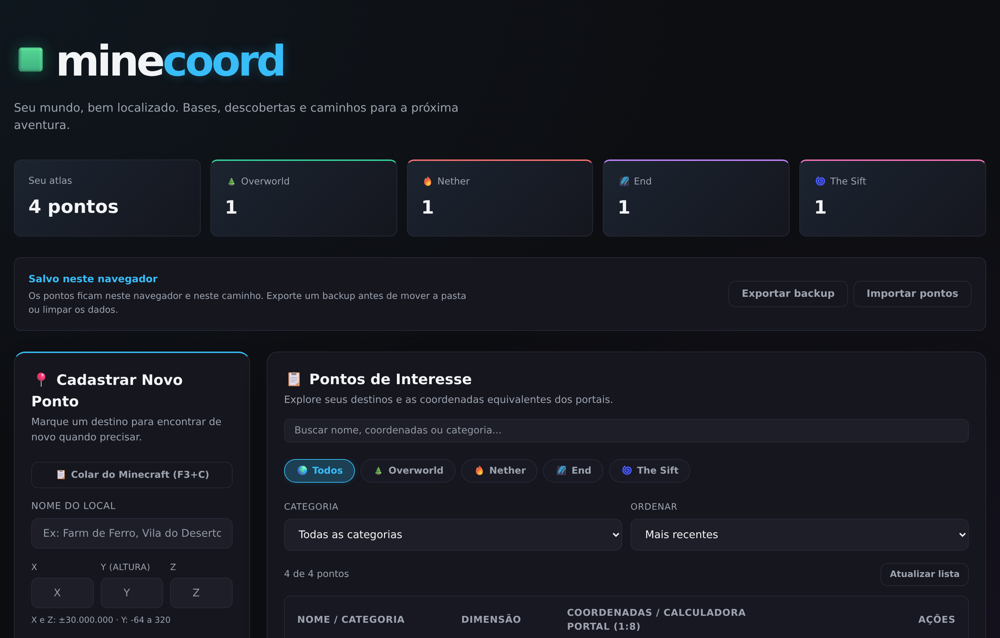

# minecoord

Seu mundo, bem localizado. Um atlas de coordenadas para organizar bases, portais e descobertas no Minecraft.

[](https://github.com/thegodKoDDa/minecoord/actions/workflows/ci.yml)
[](LICENSE)



## Recursos

- Cadastro, edição e exclusão de pontos no Overworld, Nether, End e The Sift.
- Preenchimento rápido via atalho **Colar do Minecraft (F3+C)**, com detecção automática de dimensões e coordenadas.
- Campo opcional de **anotações / descrição** para detalhes do local (baús, vilas, marcos).
- Referência de coordenadas e **cópia direta do comando `/tp` de portais** entre Overworld e Nether.
- Busca por texto (nome, categoria ou anotações), filtros por dimensão e categoria, ordenação flexível e paginação de alta performance.
- Exportação e importação de backups JSON, com suporte a números inteiros ou decimais.
- Interface responsiva, tema escuro e navegação por teclado.
- Uso direto no navegador ou com servidor local, sem build do frontend.

## Começar

### Online pelo navegador (GitHub Pages)

Acesse diretamente **[https://thegodkodda.github.io/minecoord/](https://thegodkodda.github.io/minecoord/)** para usar o atlas sem baixar ou instalar nada. Os pontos ficam salvos localmente no navegador do seu dispositivo, com exportação e importação de backups JSON.

### Sem instalação (Offline / ZIP)

[Baixe o projeto em ZIP](https://github.com/thegodKoDDa/minecoord/archive/refs/heads/main.zip), extraia a pasta e abra o **`index.html` da raiz**. Não precisa de Node.js nem internet.

Os pontos ficam no armazenamento desse navegador. Exporte um backup antes de mover a pasta, trocar de navegador ou limpar os dados. Apenas uma aba pode editar por vez; feche a editora e recarregue outra aba para transferir a edição. Navegadores sem Web Locks permitem consulta e exportação; para salvar, use o modo servidor.

### Com servidor

Requer Node.js 18 ou superior e npm.

```sh
git clone https://github.com/thegodKoDDa/minecoord.git
cd minecoord
npm ci
npm start
```

Abra **http://127.0.0.1:3000**. Os pontos ficam em `data/`, com cópia da versão anterior antes de cada alteração. Execute uma única instância por pasta de dados.

## Backups

**Exportar backup** baixa um JSON com todos os pontos. **Importar pontos** aceita esse backup ou uma lista JSON antiga e adiciona os registros sem apagar os existentes. O lote inteiro é validado antes de gravar: até 5 MB e 10.000 pontos por importação.

Importações geram novos IDs; importar o mesmo arquivo novamente duplica os pontos. Os modos navegador e servidor têm dados independentes. Para transferir entre eles, exporte de um e importe no outro.

## Configuração do servidor

Defina as variáveis no ambiente do processo. O arquivo [`.env.example`](.env.example) serve de referência; `.env` não é carregado automaticamente.

| Variável | Padrão | Uso |
| --- | --- | --- |
| `PORT` | `3000` | Porta HTTP |
| `HOST` | `127.0.0.1` | Endereço de escuta |
| `DATA_DIR` | `data/` | Diretório de coordenadas e backup |
| `AUTH_USER` | `minecoord` | Usuário da autenticação Basic |
| `AUTH_PASSWORD` | Sem senha local | Senha com pelo menos 16 caracteres; obrigatória fora do loopback |

```sh
PORT=3001 npm start
```

Ao configurar uma senha, o navegador solicita as credenciais para abrir a aplicação. Para acesso pela rede, configure `HOST` e `AUTH_PASSWORD` e use HTTPS por proxy reverso para proteger as credenciais em trânsito. A autenticação usa uma conta compartilhada, sem perfis individuais.

## Desenvolvimento

Express/CommonJS no backend e HTML, CSS e JavaScript no frontend.

```sh
npm run dev              # Reinício automático do servidor
npm run check            # Verificação de sintaxe JavaScript
npm test                 # API, persistência, validação e autenticação
npm run test:continuity  # Integridade dos checkpoints locais
```

Os testes da API usam diretórios temporários e não alteram os dados da aplicação. As verificações também rodam no GitHub Actions. Consulte [o guia de contribuição](CONTRIBUTING.md) para testes de navegador.

| Diretório | Conteúdo |
| --- | --- |
| `backend/src/` | Servidor, rotas, autenticação, validação e persistência |
| `frontend/public/` | Interface e adaptador de armazenamento |
| `data/` | Dados privados, ignorados pelo Git |
| `tests/` | Testes automatizados |
| `scripts/` | Verificações e continuidade local |
| `docs/` | Documentação e prévia da interface |

## Documentação

- [Arquitetura e API](docs/architecture.md)
- [Limitações conhecidas](docs/KNOWN_ISSUES.md)
- [Checkpoints e recuperação](docs/continuity.md)
- [Histórico de versões](CHANGELOG.md)

## Licença

[ISC](LICENSE).
